<div align="center">

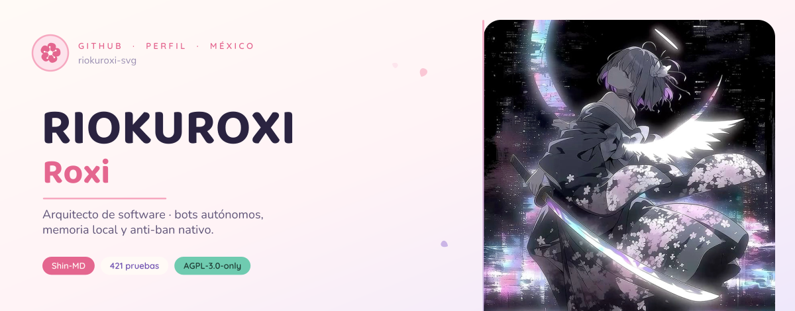

<p>
  <a href="#-sobre-mí">Sobre mí</a> ·
  <a href="#-proyectos">Proyectos</a> ·
  <a href="#-galería">Galería</a> ·
  <a href="#-lo-que-uso">Stack</a> ·
  <a href="#-ficha">Ficha</a> ·
  <a href="#-hablemos">Hablemos</a>
</p>

<p>
  <a href="https://github.com/riokuroxi-svg/Shin-MD"></a>
  <a href="https://github.com/riokuroxi-svg/Shin-MD/blob/main/LICENSE"></a>
  <a href="https://ko-fi.com/kuroxisvg"></a>
</p>

</div>


## 🌸 Sobre mí

<table>
  <tr>
    <td width="62%" valign="top">

Soy **Roxi** `riokuroxi-svg`, desarrollador y arquitecto de software desde
**México** 🇲🇽. Mi trabajo es convertir bots de mensajería en sistemas que
**aguantan**: procesos que se separan en lugar de caerse juntos, memoria que vive
en el disco del equipo y no en la nube de nadie, y decisiones heurísticas tomadas
en el momento, sin pedir permiso a una API.

- ⚙️ **Lo que hago:** núcleos de bots, colas de envío, anti-ban, memoria local
  con SQLite y un instalador que funciona igual en Termux, en un VPS y en Docker.
- 🧠 **Cómo lo hago:** primero investigo —protocolo, incidencias, cómo lo resolvió
  quien ya se estrelló— y después escribo. Cero código trampa.
- 🧪 **Cómo lo compruebo:** con pruebas que se ejecutan solas. Si una frase del
  README se puede medir, hay un archivo en `test/` que la mide.
- 🇲🇽 **Dónde:** México, con café de olla y una playlist de openings de fondo.

  </td>
    <td width="38%" align="center" valign="middle">
      
    </td>
  </tr>
</table>

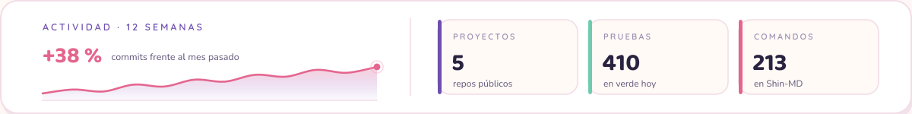


## 🚀 Proyectos

Todo cuelga de la misma idea: **un núcleo pequeño y honesto**, y encima de él las
cosas que hacen falta.

<p align="center">
  <a href="https://github.com/riokuroxi-svg/Shin-MD">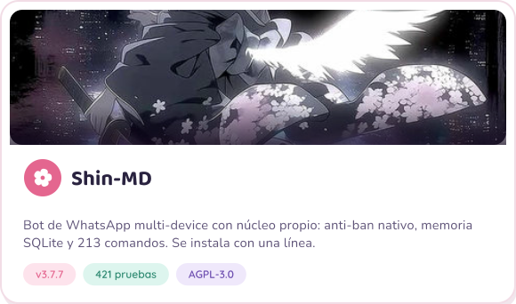</a>
  <a href="https://github.com/riokuroxi-svg/Shin-MD-Go">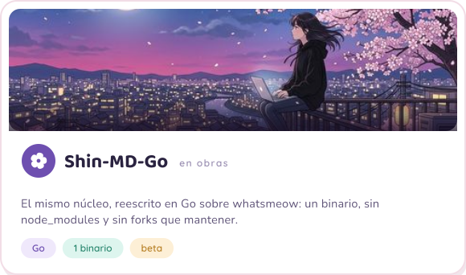</a>
  <a href="https://github.com/riokuroxi-svg/kuroxi-platform">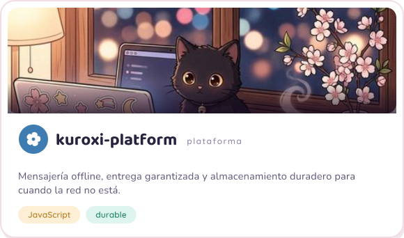</a>
  <a href="https://github.com/riokuroxi-svg/Lab2experimental">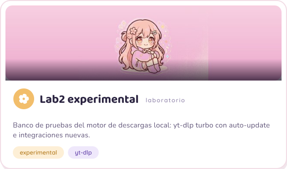</a>
  <a href="https://github.com/riokuroxi-svg/Ginko-Covers">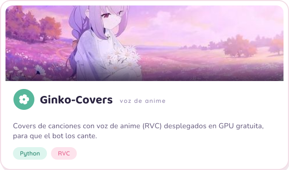</a>
</p>

**Pruébalo:** Shin-MD se instala con una línea, verifica la huella del instalador
y arranca el bot al terminar. Nada de descargar y ejecutar a ciegas:

```bash
curl -fsSL https://raw.githubusercontent.com/riokuroxi-svg/Shin-MD/v3.7.7/shin.sh | sh
```


## 🖼️ Galería

<table>
  <tr>
    <td width="33.3%">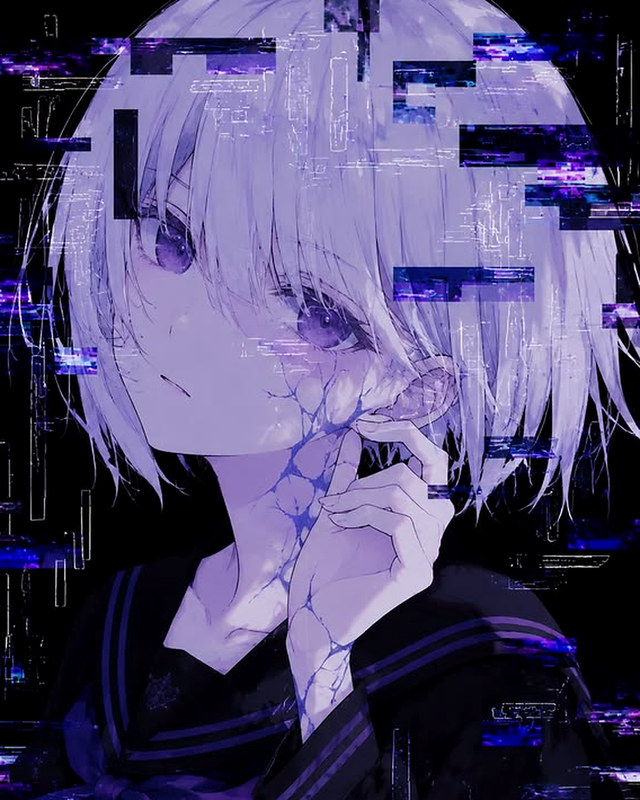</td>
    <td width="33.3%">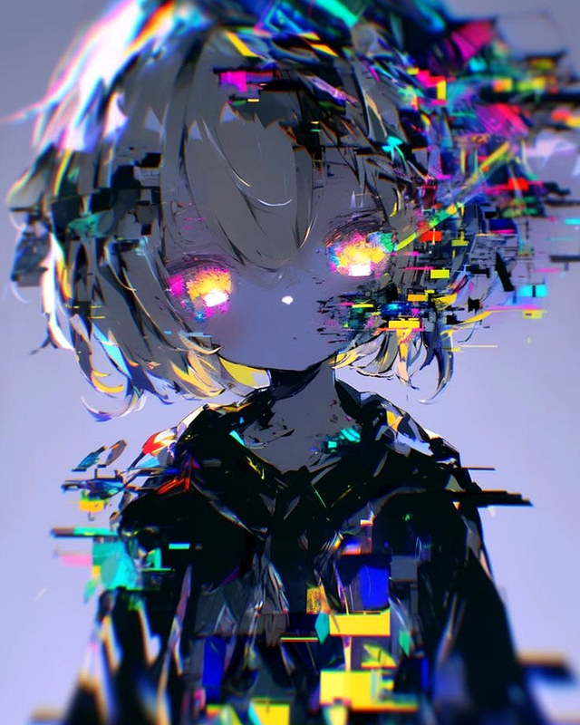</td>
    <td width="33.3%">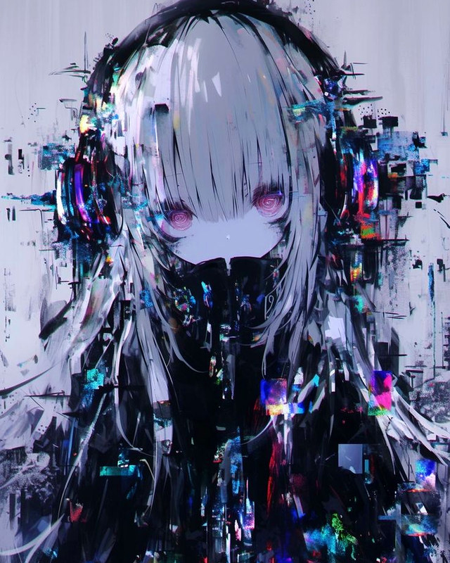</td>
  </tr>
</table>


## 🧰 Lo que uso

<div align="center">

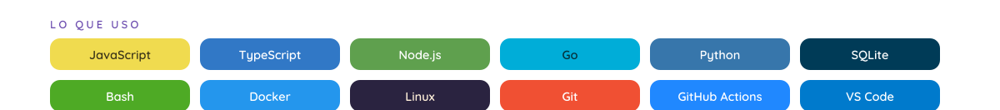

<br/><br/>

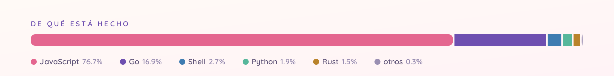

</div>

<br/>

| Terreno | Con qué |
| :--- | :--- |
| **Núcleo de bots** | `Node.js 22` (ESM, sin transpilar) · `Baileys` con parches propios · `whatsmeow` en Go |
| **Memoria y datos** | `SQLite` en modo WAL · `FTS5` para búsqueda · respaldos que no se llevan los datos por delante |
| **Inmunidad** | anti-ban con jitter, colas con prioridad, límites por capacidad, aislamiento de sub-procesos |
| **Herramientas** | `Bash` POSIX puro para los instaladores · `systemd` para el servicio · `Docker` |
| **Calidad** | runner de pruebas propio · `tsc` sobre JSDoc · cero errores de lint o no entra |


## 📇 Ficha

<table>
  <tr>
    <td width="34%" valign="top"><b>Nombre</b><br/>Roxi · <code>riokuroxi-svg</code></td>
    <td width="33%" valign="top"><b>Rol</b><br/>Arquitecto de software</td>
    <td width="33%" valign="top"><b>Base</b><br/>México 🇲🇽</td>
  </tr>
  <tr>
    <td valign="top"><b>Lenguajes de verdad</b><br/>JavaScript y Go</td>
    <td valign="top"><b>Terreno</b><br/>Bots autónomos y memoria local</td>
    <td valign="top"><b>Licencia</b><br/>AGPL-3.0-only</td>
  </tr>
  <tr>
    <td valign="top"><b>Ahora</b><br/>Shin-MD v3.7.7 en producción</td>
    <td valign="top"><b>Después</b><br/>El mismo núcleo en Go</td>
    <td valign="top"><b>Invítame</b><br/><a href="https://ko-fi.com/kuroxisvg">Ko-fi</a></td>
  </tr>
</table>


## 🐈 Fuera del teclado

<table>
  <tr>
    <td width="42%" align="center" valign="middle">
      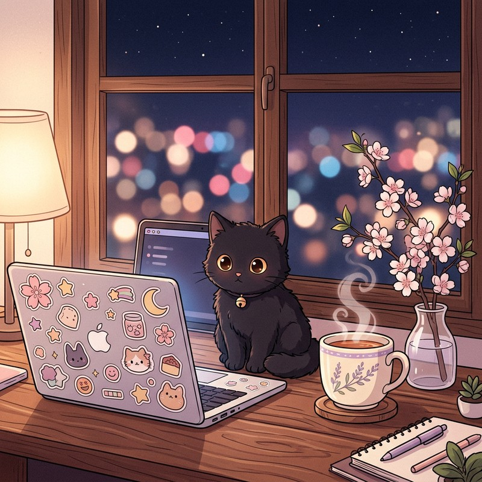
    </td>
    <td width="58%" valign="top">

- 🎧 **Sonando:** openings de los 2000 y lo-fi para las horas raras.
- 🌙 **Se programa de noche.** La mejor hora para cazar un `EEXIST` es cuando ya
  no hay nadie mirando.
- 🍵 **Café de olla**, no espresso. La taza aparece en cuanto uno se descuida.
- 🐈‍⬛ **Supervisor de calidad:** un gato negro que aprueba las releases caminando
  sobre el teclado.
- 📝 **Si algo no está escrito, no existe.** Por eso cada proyecto trae su guía de
  instalación y su informe de lo que se rompió por el camino.

  </td>
  </tr>
</table>


```zsh
roxi@shin-md:~$ neofetch --perfil
        /\\_/\\        Sistema .... Debian y Termux
       ( o.o )       Núcleo ..... Shin-MD v3.7.7
        > ^ <        Memoria .... SQLite WAL · FTS5
                     Anti-ban ... jitter + aclimatación
                     Pruebas .... 421 en verde
                     Licencia ... AGPL-3.0-only
                     Sakura ..... siempre
```


## 📬 Hablemos

<div align="center">

¿Un bot que se cae cada semana? ¿Una migración que da miedo?

<p>
  <a href="https://github.com/riokuroxi-svg?tab=repositories"></a>
  <a href="https://ko-fi.com/kuroxisvg"></a>
  <a href="https://github.com/riokuroxi-svg/Shin-MD/issues"></a>
</p>

</div>


<!--
  Ninguna pieza de este perfil se sirve desde fuera: ni shields.io, ni
  github-readme-stats, ni skillicons, ni giphy. Todo —portada, estadísticas,
  insignias, stack, tarjetas, divisor y pie— se dibuja con código en tools/:

      python3 tools/preparar_arte.py   # ilustraciones (recorte, nitidez, JPEG 4:4:4)
      python3 tools/build_assets.py    # todas las piezas de assets/
      python3 tools/preview.py         # hoja de revisión: assets/preview.svg

  El texto va convertido a trazado, así que no depende de ninguna fuente
  instalada. Las ilustraciones son originales de este repositorio.
-->
