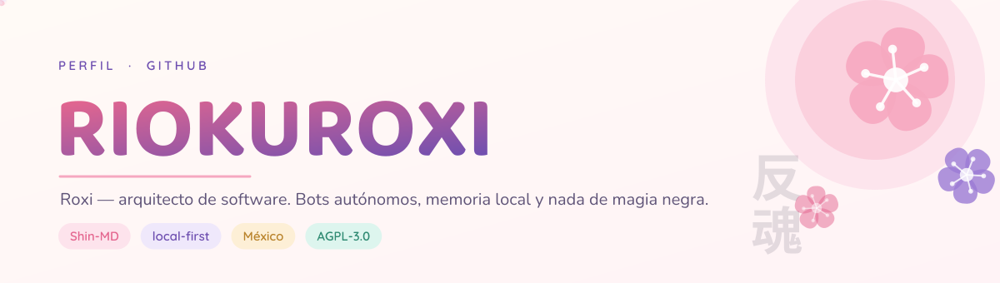

<div align="center">



<p>
  <a href="#-sobre-mí">Sobre mí</a> ·
  <a href="#-proyectos">Proyectos</a> ·
  <a href="#-lo-que-uso">Stack</a> ·
  <a href="#-en-números">Números</a> ·
  <a href="#-fuera-del-teclado">Fuera del teclado</a> ·
  <a href="#-hablemos">Hablemos</a>
</p>


</div>


## 🌸 Sobre mí

Soy **Roxi** `riokuroxi-svg`, desarrollador y arquitecto de software desde
**México** 🇲🇽. Mi trabajo es convertir bots de mensajería en sistemas que
**aguantan**: procesos que se separan en lugar de caerse juntos, memoria que vive
en el disco del equipo y no en la nube de nadie, y decisiones heurísticas tomadas
en el momento, sin pedir permiso a una API.

- ⚙️ **Lo que hago:** núcleos de bots, colas de envío, anti-ban, memoria local
  con SQLite y un instalador que funciona igual en Termux, en un VPS y en Docker.
- 🧠 **Cómo lo hago:** primero investigo —protocolo, incidencias, cómo lo resuelve
  quien ya se estrelló— y después escribo. Cero código trampa, cero dependencias
  que sobren.
- 🧪 **Cómo lo compruebo:** con pruebas que se ejecutan solas. Si una frase del
  README se puede medir, hay un archivo en `test/` que la mide.
- 🇲🇽 **Dónde:** México, con café de olla y una playlist de openings de fondo.

<p>
  <a href="https://github.com/riokuroxi-svg/Shin-MD">
    
  </a>
  <a href="https://github.com/riokuroxi-svg?tab=repositories">
    
  </a>
  <a href="https://ko-fi.com/kuroxisvg">
    
  </a>
</p>


## 🚀 Proyectos

Todo cuelga de la misma idea: **un núcleo pequeño y honesto**, y encima de él las
cosas que hacen falta.

<p align="center">
  <a href="https://github.com/riokuroxi-svg/Shin-MD"></a>
  <a href="https://github.com/riokuroxi-svg/Shin-MD-Go"></a>
  <a href="https://github.com/riokuroxi-svg/kuroxi-platform"></a>
  <a href="https://github.com/riokuroxi-svg/Lab2experimental"></a>
  <a href="https://github.com/riokuroxi-svg/Ginko-Covers"></a>
</p>

**Pruébalo:** Shin-MD se instala con una línea, verifica la huella del instalador
y arranca el bot al terminar. Nada de descargar y ejecutar a ciegas:

```bash
curl -fsSL https://raw.githubusercontent.com/riokuroxi-svg/Shin-MD/v3.7.0/shin.sh | sh
```


## 🧰 Lo que uso

<div align="center">


<br/><br/>


</div>

| Terreno | Con qué lo trabajo |
| :--- | :--- |
| **Núcleo de bots** | `Node.js 22` (ESM, sin transpilar) · `Baileys` con parches propios · `whatsmeow` en Go |
| **Memoria y datos** | `SQLite` en modo WAL · `FTS5` para búsqueda · respaldos que no se llevan los datos por delante |
| **Inmunidad** | anti-ban con jitter, colas con prioridad, límites por capacidad, aislamiento de sub-procesos |
| **Herramientas** | `Bash` POSIX puro para los instaladores · `systemd` para el servicio · `Docker` |
| **Calidad** | runner de pruebas propio · `tsc` sobre JSDoc · cero errores de lint o no entra |


## 📊 En números

<div align="center">

|  |  |  |
| :---: | :---: | :---: |
| **213**<br/>comandos en Shin-MD | **353**<br/>pruebas en verde | **520**<br/>commits propios |
| **13**<br/>repositorios | **2**<br/>lenguajes de verdad | **1**<br/>línea para instalar |

<br/>

<a href="https://github.com/riokuroxi-svg/Shin-MD">
  
</a>

</div>


## 🐈 Fuera del teclado

<table>
  <tr>
    <td width="42%" align="center" valign="middle">
      
    </td>
    <td width="58%" valign="top">

- 🎧 **Sonando:** openings de los 2000 y lo-fi para las horas raras.
- 🌙 **Se programa de noche.** La mejor hora para cazar un `EEXIST` es cuando ya
  no hay nadie mirando.
- 🍵 **Café de olla**, no espresso. La taza aparece en cuanto uno se descuida.
- 🐈‍⬛ **Supervisor de calidad:** un gato negro que aprueba las releases caminando
  sobre el teclado.
- 📝 **Si algo no está escrito, no existe.** Por eso cada proyecto trae su guía
  de instalación y su informe de lo que se rompió por el camino.

  </td>
  </tr>
</table>


```zsh
roxi@shin-md:~$ neofetch --perfil
        /\_/\        Sistema .... Debian y Termux
       ( o.o )       Núcleo ..... Shin-MD v3.7.0
        > ^ <        Memoria .... SQLite WAL · FTS5
                     Anti-ban ... jitter + aclimatación
                     Pruebas .... 353 en verde
                     Licencia ... AGPL-3.0-only
                     Sakura ..... siempre
```


## 📬 Hablemos

<div align="center">

¿Un bot que se cae cada semana? ¿Una migración que da miedo?

<p>
  <a href="https://github.com/riokuroxi-svg?tab=repositories"></a>
  <a href="https://ko-fi.com/kuroxisvg"></a>
  <a href="https://github.com/riokuroxi-svg/Shin-MD/issues"></a>
</p>

</div>


<!--
  Las piezas de assets/ (hero, divisor, pie, lenguajes y tarjetas) se dibujan
  solas, con código:  python3 tools/build_assets.py   (ver tools/LEEME.md)
  El texto va convertido a trazado vectorial, así que se ven igual en cualquier
  navegador o móvil, sin depender de fuentes instaladas.
  Las ilustraciones de assets/anime/ son originales de este repositorio.
-->
